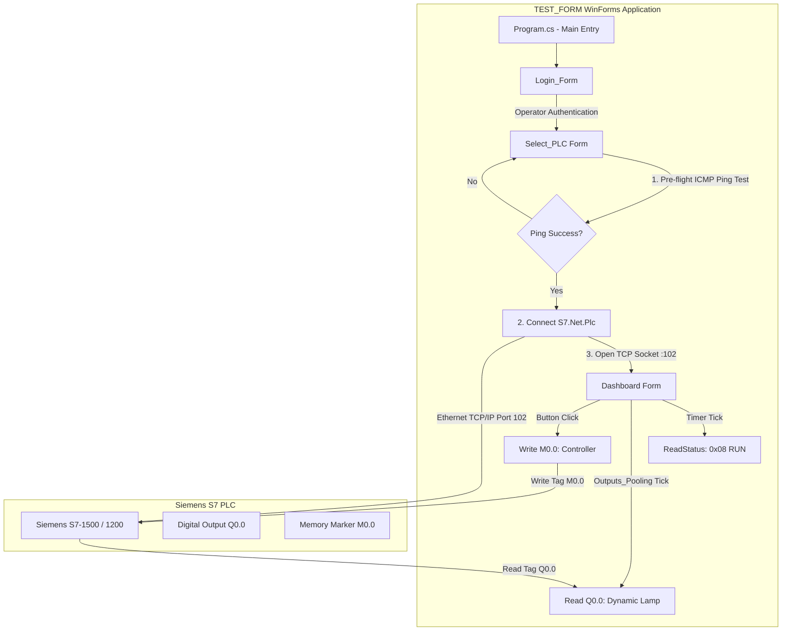

# System Architecture Documentation: C# Siemens S7 HMI/SCADA Application

> **Notice for AI Assistants & LLM Agents:**  
> This architecture document provides a technical overview of the C# Siemens S7 HMI/SCADA project (Project ID: 007/2025). Use this document to understand the project layout, data flows, hardware integration protocols, component dependencies, and design patterns.

---

## 1. Executive Summary

This repository contains a **Windows Forms (.NET Framework 4.7.2)** desktop Human-Machine Interface (HMI) / SCADA monitoring and control application (**`TEST_FORM`**) designed to interface with **Siemens S7 Programmable Logic Controllers (PLCs)** over Ethernet via the ISO-on-TCP (RFC 1006) protocol. 

The application enables industrial operators to authenticate, ping and connect to Siemens controllers (S7-200, S7-300, S7-400, S7-1200, S7-1500), monitor controller operational state in real-time, poll digital output states (e.g. `%Q0.0`), and dispatch remote machine control commands (e.g. `%M0.0`).

---

## 2. Technology Stack & Dependencies

| Layer / Aspect | Technology / Library | Description |
| :--- | :--- | :--- |
| **Target Framework** | .NET Framework 4.7.2 | Windows Forms (WinForms) Desktop Application |
| **Language** | C# 7.3 | Managed object-oriented code |
| **PLC Communication Library** | `S7netplus` (`v0.20.0`) | Open-source S7 communication library for Siemens PLCs over TCP/IP (ISO-on-TCP RFC 1006, Port 102) |
| **Network Tools** | `System.Net.NetworkInformation` | ICMP Ping validation before establishing socket connection |
| **PLC Engineering Tool** | Siemens TIA Portal v19 | Engineering environment for PLC logic, tag tables, and hardware configuration |

---

## 3. High-Level System Architecture & Data Flow



---

## 4. Repository Directory Structure

```
2025_007_csharp_siemens_hmi/
│
├── ARCHITECTURE.md                  # System architecture and engineering reference
├── README.md                        # Primary GitHub documentation and user guide
├── LICENSE                          # MIT License (2025)
├── .gitignore                       # Git exclusion rules (ignores TIA blobs, build artifacts)
├── S7_DLL_DOCUMENTATION.pdf         # Reference manual for S7.Net communication library
├── TIA_V19_CONFIG_REPORT.pdf        # Hardware configuration and network report
├── 800x480_blrbgimg.png             # UI background image asset
├── lamp_green.jpg                   # Status indicator: Running state
├── lamp_red.jpg                     # Status indicator: Stopped state
├── lamp_error.jpg                   # Status indicator: Exception / Error state
├── logo_ICO.ico                     # Application icon
├── logo_JPG.jpg                     # Application branding graphic
├── login screen.png                 # Application login capture
├── config screen.png                # Hardware connection setup capture
├── dashboard.png                    # Live SCADA telemetry capture
├── TIA_V19 view.png                 # Siemens TIA Portal v19 engineering capture
├── Demo_video.mp4                   # Full video demonstration
│
└── TEST_FORM/                       # C# WinForms Solution & Project
    ├── TEST_FORM.slnx               # Visual Studio Solution Index
    ├── TEST_FORM.csproj             # C# Project File (.NET Framework 4.7.2)
    ├── packages.config              # NuGet dependencies (S7netplus 0.20.0, System.Buffers, etc.)
    ├── Program.cs                   # Application entry point ([STAThread] Main())
    ├── Login_Form.cs                # Form 1: Authentication & User Login
    ├── Login_Form.Designer.cs       # Generated layout for Login_Form
    ├── Login_Form.resx              # Resource file for Login_Form
    ├── Select_PLC.cs                # Form 2: IP Ping Verification & S7.Net Driver Config
    ├── Select_PLC.Designer.cs       # Generated layout for Select_PLC
    ├── Select_PLC.resx              # Resource file for Select_PLC
    ├── Dashboard.cs                 # Form 3: Real-Time SCADA/HMI Control & Tag Polling
    ├── Dashboard.Designer.cs        # Generated layout for Dashboard
    ├── Dashboard.resx               # Resource file for Dashboard
    ├── App.config                   # .NET Application configuration
    └── Properties/                  # Assembly metadata & embedded resources
```

---

## 5. Detailed Component Breakdown

### 5.1 Application Entry & Life Cycle
- **[Program.cs](TEST_FORM/Program.cs)**:
  - Invokes `Application.EnableVisualStyles()` and launches `Login_form` as the primary application UI thread loop.

### 5.2 Form 1: Authentication (`Login_Form`)
- **File**: `Login_Form.cs` ([Login_Form.cs](TEST_FORM/Login_Form.cs))
- **Responsibilities**:
  - Handles operator authentication verification against authorized application credentials.
  - Runs a 1-second system clock timer (`timer1_Tick`) updating formatted date and time labels.
  - On successful login, passes authenticated operator identity to `Select_PLC` form, hides `Login_form`, and hooks into `FormClosed` to shut down the application cleanly.

### 5.3 Form 2: PLC Configuration & Connection Setup (`Select_PLC`)
- **File**: `Select_PLC.cs` ([Select_PLC.cs](TEST_FORM/Select_PLC.cs))
- **Responsibilities**:
  - Configures target CPU type from `S7.Net.CpuType` enum (`S7-200`, `S7-300`, `S7-400`, `S7-1200`, `S7-1500`). Default selection is `S7-1500`.
  - Configures Rack (default `0`) and Slot (default `1`).
  - **Network Validation**: Performs an ICMP `Ping.Send()` check against target IP with a 1000ms timeout.
  - **Connection Instantiation**:
    ```csharp
    Plc plc = new Plc(cpu, PLC_IP, rack, slot);
    plc.Open();
    ```
  - Passes the instantiated and connected `Plc` object into `Dashboard`'s constructor via dependency injection.

### 5.4 Form 3: Operational SCADA Dashboard (`Dashboard`)
- **File**: `Dashboard.cs` ([Dashboard.cs](TEST_FORM/Dashboard.cs))
- **Responsibilities**:
  - **State Monitoring (`timer1_Tick`)**:
    - Executes `plc.ReadStatus()` every tick.
    - If status equals `0x08` (PLC RUN state), displays "PLC Online" with a green background.
    - On exception (e.g. disconnected cable), displays "PLC Offline" with red background and disables control panels.
  - **Tag Polling (`Outputs_Pooling_Tick`)**:
    - Polls digital output tag `Q0.0` using `(bool)plc.Read("Q0.0")`.
    - Updates `PIC_lamp_status` image (`lamp_green` when true, `lamp_red` when false, `lamp_error` on read failure).
  - **Control Commands**:
    - `button1_Click`: Writes `M0.0 = true` to PLC memory marker.
    - `button2_Click`: Writes `M0.0 = false` to PLC memory marker.
  - **Resource Cleanup**:
    - `Dashboard_FormClosed` / `btnShutdown_Click`: Safely calls `plc.Close()` to release TCP socket connections and cleanly exits the application.

---

## 6. Data Tag & Memory Mapping

The current HMI implementation interacts with the following PLC tags:

| Address | Data Type | Access | Function in Application |
| :--- | :--- | :--- | :--- |
| **`Q0.0`** | `Boolean` (Bit) | Read | Output indicator for machine operation status (Green = Running, Red = Stopped) |
| **`M0.0`** | `Boolean` (Bit) | Write | Start / Stop memory flag triggered by UI pushbuttons |

---

## 7. Essential Guidelines for Industrial Deployment & Developers

### 1. S7.Net Thread Safety & Non-Blocking I/O
- `S7.Net.Plc` methods (`Read`, `Write`, `ReadStatus`, `Open`, `Close`) execute **synchronous blocking socket operations**.
- Currently, calls in `Dashboard.cs` run inside WinForms `Timer` ticks on the main UI thread. 
- *Recommendation for production expansion*: Wrap heavy tag reads/writes (or Data Block reads) in `Task.Run()` or use `async`/`await` patterns to avoid freezing the UI thread during transient network latency spikes.

### 2. S7 Communication Configuration Parameters
- **S7-1200 / S7-1500 PLCs**: Rack is typically `0`, Slot is typically `1`.
- **S7-300 / S7-400 PLCs**: Rack is typically `0`, Slot is typically `2`.
- **Siemens Security Settings**: In TIA Portal v19, ensure:
  - **"Permit access with PUT/GET communication from remote partner"** is enabled in CPU Protection settings.
  - Optimized block access is disabled for Data Blocks if accessing DB addresses directly by byte offset (e.g., `DB1.DBX0.0`).

### 3. Error Handling & Connection Recovery
- Always wrap `plc.Read()` and `plc.Write()` inside `try-catch` blocks.
- Check `plc.IsConnected` before attempting tag operations. Re-establish connection (`plc.Open()`) if network loss occurs.

---

## 8. Build & Execution Workflow

### Prerequisites
1. Microsoft Visual Studio 2019/2022 or .NET SDK (.NET Framework 4.7.2 targeting pack).
2. Siemens TIA Portal v19 (optional, for configuring physical PLC or PLCSIM Advanced).
3. Network access to a physical Siemens S7 PLC or Siemens PLCSIM Advanced controller on the local automation network.

### Building the Project
```powershell
# Restore NuGet dependencies and build solution
dotnet build TEST_FORM\TEST_FORM.csproj -c Release
```
The compiled executable will be generated at `TEST_FORM\bin\Release\TEST_FORM.exe`.
