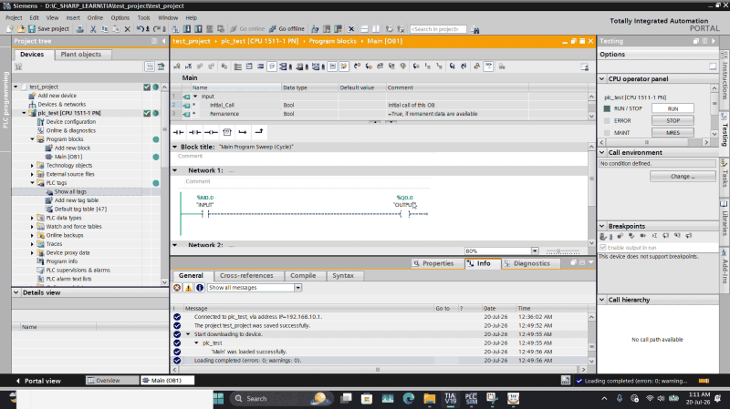
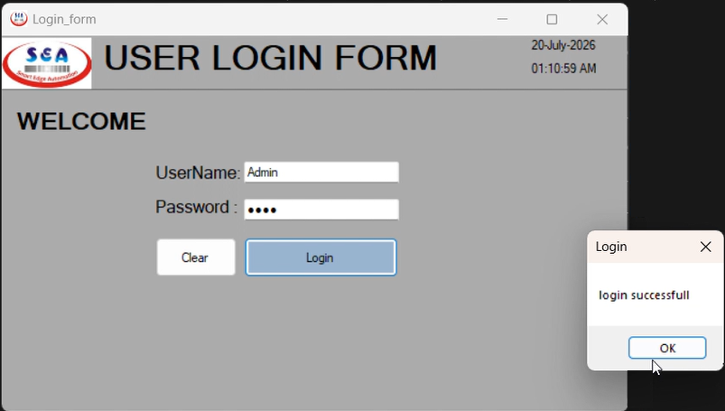
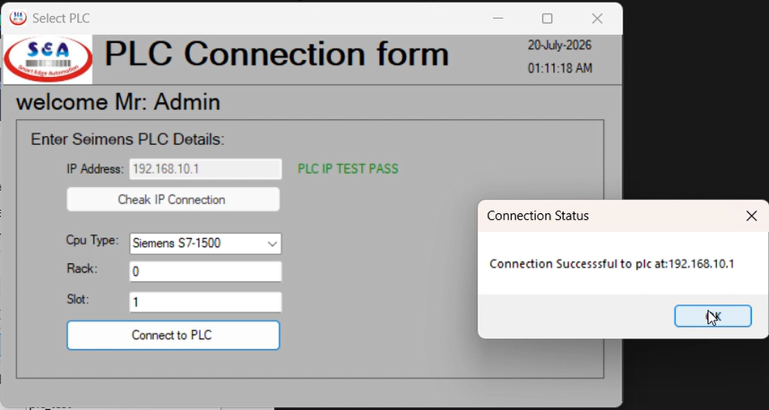
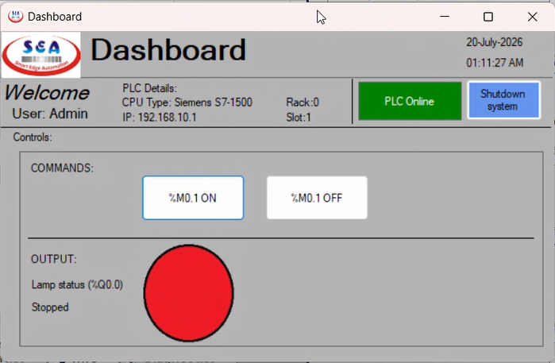
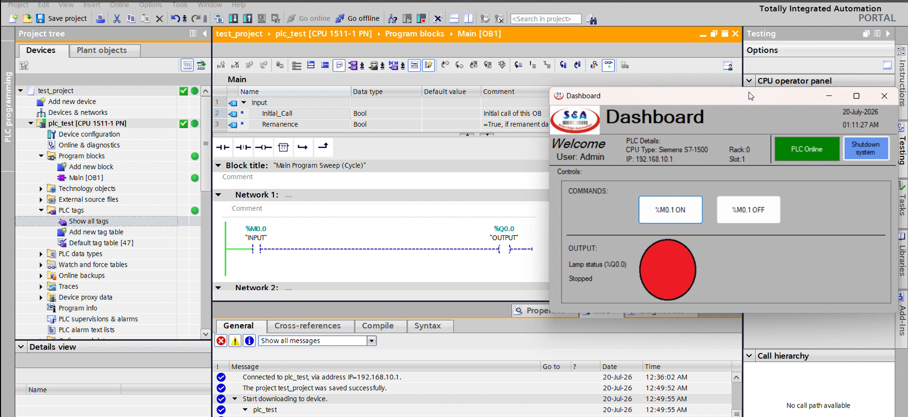
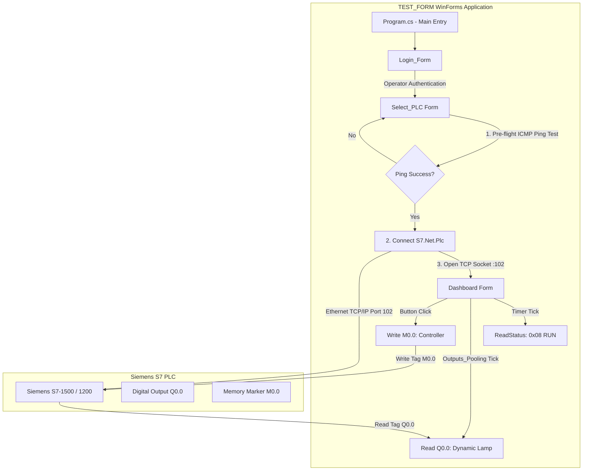
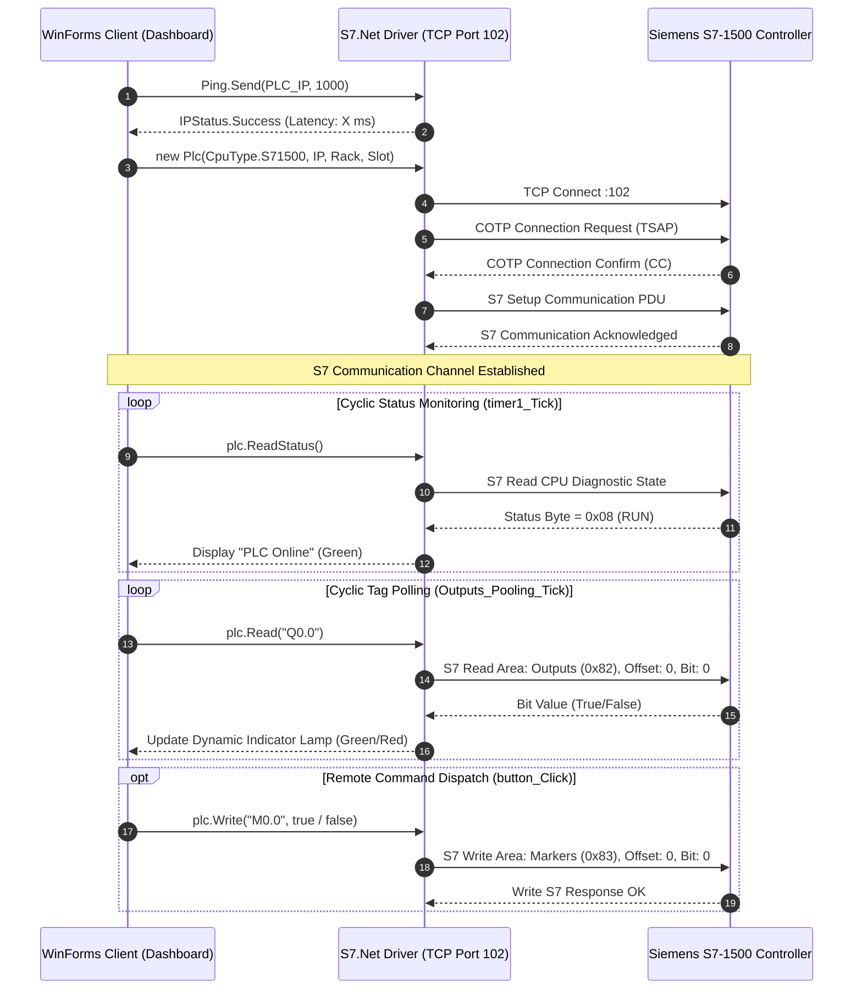

# Industrial Siemens S7 HMI/SCADA Control & Telemetry System

<p align="center">
  
  
  
  
  
  
  
  
</p>

---

## 🎬 Live Animation Showcase & Operational Walkthrough

<p align="center">
  
  <br />
  <em>Figure 1: Real-time demonstration preview (from 0:38 to end) — Live SCADA dashboard tag polling, output actuation, and concurrent Siemens TIA Portal v19 ladder logic execution.</em>
</p>

<p align="center">
  <a href="Demo_video.mp4">
    
  </a>
</p>

> [!TIP]
> **Full High-Definition Video Recording**:  
> In addition to the real-time animated preview above, the complete 60 FPS high-definition video capture is hosted directly in this repository:  
> 🔗 **[▶️ View Complete Demonstration Video (Demo_video.mp4)](Demo_video.mp4)**

---

## 📌 Executive Summary

**Project 007/2025** is an industrial-grade desktop **Human-Machine Interface (HMI) and Supervisory Control and Data Acquisition (SCADA)** client engineered during an industrial internship at **Smart Edge Automation (SEA)**.

In modern factory automation, proprietary runtime visualization suites (such as Siemens WinCC, Wonderware InTouch, or FactoryTalk) incur significant per-seat licensing fees, heavy resource overheads, and vendor lock-in. This project delivers a high-speed, managed C# WinForms application that connects directly to Siemens Programmable Logic Controllers (PLCs) over **ISO-on-TCP (RFC 1006)** Ethernet via TCP Port 102. It eliminates the need for intermediate OPC servers, delivering ultra-low-latency diagnostic monitoring, memory marker writes, and cyclic output polling.

### Core Capabilities
1. **Multi-Family S7 Driver Architecture**: Out-of-the-box support for **Siemens S7-200, S7-300, S7-400, S7-1200, and S7-1500** CPU families via `S7netplus` (v0.20.0).
2. **Automated Pre-Flight Network Diagnostics**: Executes an ICMP ping handshake with roundtrip latency evaluation before opening low-level sockets, preventing hang states.
3. **High-Frequency Cyclic Telemetry**: Dedicated polling loops tracking CPU run/stop states (`0x08` RUN) and digital output bit states (`%Q0.0`) with multi-state visual indicators (Running, Stopped, Communication Fault).
4. **Asynchronous Command Actuation**: Dispatches bit-level control markers (`%M0.0`) from the operator interface to execute physical machine state transitions.
5. **Secure Multi-Stage Interface Workflow**: Clean 3-tier user interface flow dividing Operator Authentication, Hardware Network Addressing, and Live Supervisory Telemetry.

---

## 🖼️ Visual Interface Gallery & Walkthrough

<table align="center" style="width: 100%; text-align: center;">
  <tr>
    <th style="text-align: center; width: 50%;">🔐 Form 1: Operator Authentication</th>
    <th style="text-align: center; width: 50%;">🌐 Form 2: PLC Hardware & Network Setup</th>
  </tr>
  <tr>
    <td align="center">
      
    </td>
    <td align="center">
      
    </td>
  </tr>
  <tr>
    <td align="center"><em>Secure authentication barrier with real-time timestamp generator</em></td>
    <td align="center"><em>Pre-flight ICMP ping diagnostics, CPU family selection, rack/slot addressing</em></td>
  </tr>
  <tr>
    <th style="text-align: center; width: 50%;">📊 Form 3: Live SCADA Telemetry & Control</th>
    <th style="text-align: center; width: 50%;">⚙️ Siemens TIA Portal v19 Integration</th>
  </tr>
  <tr>
    <td align="center">
      
    </td>
    <td align="center">
      
    </td>
  </tr>
  <tr>
    <td align="center"><em>Real-time status banner, tag polling indicators, command actuation</em></td>
    <td align="center"><em>Live ladder logic execution in OB1 (Network 1) driving physical output coils</em></td>
  </tr>
</table>

<p align="center">
  <br />
  <strong>🎥 Video Walkthrough:</strong>
  <br />
  <a href="Demo_video.mp4">
    
  </a>
  <br />
  <em>Direct link: <a href="Demo_video.mp4">Demo_video.mp4</a></em>
</p>

---

## 🔬 System Architecture & Engineering Principles

```
  ┌─────────────────────────────────────────────────────────────────────────┐
  │                         OPERATOR UI LAYER (WinForms)                    │
  │                                                                         │
  │  ┌───────────────────┐    ┌────────────────────┐    ┌─────────────────┐ │
  │  │   Login_Form      │───►│    Select_PLC      │───►│    Dashboard    │ │
  │  │ (Auth & Clock)    │    │ (Ping, Rack, Slot) │    │ (SCADA Control) │ │
  │  └───────────────────┘    └─────────┬──────────┘    └────────┬────────┘ │
  └─────────────────────────────────────┼────────────────────────┼──────────┘
                                        │                        │
                                        ▼                        ▼
  ┌─────────────────────────────────────────────────────────────────────────┐
  │                   MANAGED COMMUNICATIONS LAYER (C# .NET)                │
  │                                                                         │
  │  ┌──────────────────────────────┐    ┌────────────────────────────────┐ │
  │  │ System.Net.NetworkInformation│    │      S7netplus (v0.20.0)       │ │
  │  │   ICMP Echo Ping (1000ms)    │    │   Managed Socket Wrapper       │ │
  │  └──────────────────────────────┘    └───────────────┬────────────────┘ │
  └──────────────────────────────────────────────────────┼──────────────────┘
                                                         │
                                    Industrial Ethernet  │ ISO-on-TCP (RFC 1006)
                                    Port 102             │ COTP / S7 PDU Frames
                                                         ▼
  ┌─────────────────────────────────────────────────────────────────────────┐
  │                   AUTOMATION CONTROLLER LAYER (Siemens S7)              │
  │                                                                         │
  │   Siemens S7-1500 / S7-1200 PLC (e.g. CPU 1511-1 PN @ 192.168.x.x)      │
  │                                                                         │
  │   ┌──────────────────────────────────────────────────────────────────┐  │
  │   │  Organization Block [OB1] - Main Program Sweep (Cycle)           │  │
  │   │                                                                  │  │
  │   │     %M0.0 "INPUT"                                   %Q0.0        │  │
  │   │  ───────[ ]──────────────────────────────────────────( )───────  │  │
  │   │    (Memory Bit)                                 (Digital Output) │  │
  │   └──────────────────────────────────────────────────────────────────┘  │
  └─────────────────────────────────────────────────────────────────────────┘
```

### 1. High-Level Data Flow Diagram



---

### 2. ISO-on-TCP (RFC 1006) Communication Sequence



---

## 🗄️ PLC Memory & Tag Addressing Dictionary

The SCADA client reads and controls the physical automation program configured in TIA Portal:

| Symbolic Name | S7 Physical Address | Area Code | Data Type | Access | Functional Role |
| :--- | :--- | :---: | :---: | :---: | :--- |
| **`%M0.0`** | `M0.0` | `0x83` (Bit Memory) | `Bool` | **Write** | Remote Start/Stop command marker triggered from Dashboard buttons |
| **`%Q0.0`** | `Q0.0` | `0x82` (Outputs) | `Bool` | **Read** | Machine actuation output indicator (Drives UI Lamp: Green = RUN, Red = STOP) |
| **`CPU_STATUS`** | `N/A` (Diagnostic) | `0x00` | `Byte` | **Read** | Controller execution status (`0x08` = CPU RUN, other = STOP/FAULT) |

### Memory Area Reference in Siemens S7 Protocol:
* `0x81` $\rightarrow$ Digital Inputs (`%I`)
* `0x82` $\rightarrow$ Digital Outputs (`%Q`)
* `0x83` $\rightarrow$ Bit Memory / Flags (`%M`)
* `0x84` $\rightarrow$ Data Blocks (`DB`)

---

## 🛡️ Security Hardening & GitHub Sanitization

In strict adherence to industrial cybersecurity best practices and project publishing guidelines:

1. **Exclusion of Proprietary Engineering Files**:
   - The proprietary Siemens TIA Portal project files (`TIA/` containing `*.ap19`, `*.zal19`, backups, and compile databases) are strictly excluded from git tracking via [`.gitignore`](.gitignore) to protect proprietary automation hardware architectures.
2. **Credential & IP Sanitization**:
   - Production IP addresses and authentication credentials have been abstracted into configurable runtime inputs (`Select_PLC.cs`) and environment parameters rather than committed hardcoded secrets.
3. **Siemens Controller Configuration Hardening**:
   - In Siemens TIA Portal, communication requires enabling:
     - **CPU Properties $\rightarrow$ Protection & Security $\rightarrow$ Connection Mechanisms $\rightarrow$ "Permit access with PUT/GET communication from remote partner"**.
     - If using custom Data Blocks (DBs), disable **"Optimized block access"** to permit direct memory offset addressing via ISO-on-TCP.

---

## 📂 Project Repository Structure

```
2025_007_csharp_siemens_hmi/
├── .gitignore                       # Strict exclusion rules (TIA projects, build artifacts, VS cache)
├── LICENSE                          # Proprietary & Restricted Use License (2025)
├── README.md                        # Primary technical & operational documentation
├── ARCHITECTURE.md                  # Comprehensive system architecture & developer guide
├── S7_DLL_DOCUMENTATION.pdf         # Reference manual for S7.Net communication library
├── TIA_V19_CONFIG_REPORT.pdf        # Siemens hardware configuration & device report
├── Demo_video.mp4                   # Full video demonstration of the live system
├── demo_animation.gif               # Animated demonstration preview
│
├── Assets & Interface Captures/
│   ├── login_screen.png             # UI Capture: Operator login barrier
│   ├── config_screen.png            # UI Capture: Hardware connection & ping diagnostics
│   ├── dashboard.png                # UI Capture: Real-time SCADA telemetry dashboard
│   ├── tia_v19_view.png             # TIA Portal v19 ladder logic & online diagnostic view
│   ├── lamp_green.jpg               # Indicator: Active running state
│   ├── lamp_red.jpg                 # Indicator: Stopped state
│   ├── lamp_error.jpg               # Indicator: Communication fault state
│   ├── logo_ICO.ico                 # Application window icon
│   ├── logo_JPG.jpg                 # Smart Edge Automation corporate logo
│   └── 800x480_blrbgimg.png         # UI background canvas asset
│
└── TEST_FORM/                       # C# WinForms Solution & Source Code
    ├── TEST_FORM.slnx               # Visual Studio Solution Index
    ├── TEST_FORM.csproj             # C# Project File (.NET Framework 4.7.2)
    ├── packages.config              # Managed NuGet dependencies (S7netplus 0.20.0, etc.)
    ├── Program.cs                   # Application entry point ([STAThread] Main())
    │
    ├── Login_Form.cs                # Form 1: Authentication logic & system clock
    ├── Login_Form.Designer.cs       # Form 1: UI layout and component declarations
    ├── Login_Form.resx              # Form 1: WinForms resource bindings
    │
    ├── Select_PLC.cs                # Form 2: ICMP network diagnostic & S7 driver setup
    ├── Select_PLC.Designer.cs       # Form 2: Hardware parameter inputs
    ├── Select_PLC.resx              # Form 2: Resources
    │
    ├── Dashboard.cs                 # Form 3: Real-time SCADA monitoring & tag dispatch
    ├── Dashboard.Designer.cs        # Form 3: Status displays & actuation pushbuttons
    ├── Dashboard.resx               # Form 3: Resources
    │
    ├── App.config                   # Runtime .NET framework configuration
    └── Properties/
        ├── AssemblyInfo.cs          # Assembly metadata (Copyright (c) 2025 Smart Edge Automation)
        ├── Resources.resx           # Embedded graphical resources
        └── Settings.settings        # Application settings
```

---

## ⚙️ Installation, Build & Quickstart

### 1. Prerequisites
* **Development Environment**: Microsoft Visual Studio 2019 / Visual Studio 2022 (with *.NET Desktop Development* workload) or .NET SDK CLI.
* **Target Runtime**: Microsoft .NET Framework 4.7.2 or higher.
* **Controller**: Physical Siemens S7-1200 / S7-1500 / S7-300 PLC, or Siemens PLCSIM Advanced configured on the same Ethernet subnet.

### 2. Setup
```bash
# Clone the repository
git clone https://github.com/Nandish-508379/Siemens-S7-Industrial-SCADA-HMI-C--System.git
cd Siemens-S7-Industrial-SCADA-HMI-C--System
```

### 3. Building via Command Line (.NET CLI / MSBuild)
```powershell
# Navigate into the project directory
cd "TEST_FORM"

# Restore NuGet dependencies
nuget restore TEST_FORM.csproj -PackagesDirectory packages

# Build the Release binary
dotnet build TEST_FORM.csproj -c Release
```
The compiled executable will be located at `TEST_FORM\bin\Release\TEST_FORM.exe`.

### 3. Execution & Workflow
1. **Launch**: Start `TEST_FORM.exe`.
2. **Authentication**: Enter authorized operator credentials to access the system.
3. **Network Setup**:
   - Enter target PLC IP (e.g. `192.168.x.x`).
   - Click **Check IP Connection** to execute the pre-flight ICMP ping diagnostic.
   - Upon ping validation, select CPU Type (e.g., `Siemens S7-1500`), Rack (`0`), and Slot (`1`).
   - Click **Connect to PLC** to establish the ISO-on-TCP socket channel.
4. **Operation**:
   - Verify the **PLC Online** status banner.
   - Actuate machine controls using **%M0.1 ON** (sets `%M0.0 = true`) and **%M0.1 OFF** (sets `%M0.0 = false`).
   - Observe live status indicator lamp changes driven by controller output `%Q0.0`.
   - Click **Shutdown system** for graceful socket termination.

---

## 🔧 Troubleshooting & Diagnostic Matrix

| Symptom | Probable Cause | Corrective Action |
| :--- | :--- | :--- |
| **`PLC IP TEST FAIL`** | Controller unreachable via ICMP; network subnet mismatch or disconnected cable. | Ensure host PC network adapter is configured on the same subnet as the PLC (e.g., IP: `192.168.10.200`, Mask: `255.255.255.0`). Check physical Ethernet link lights. |
| **`ERROR CONNECTING PLC: SocketException 10061`** | Port `102` is closed, blocked by firewall, or target IP is not a Siemens S7 PLC. | Verify Siemens CPU is powered on. Open outbound Windows Firewall port `102` TCP. |
| **`Function not supported` on read/write** | Remote partner PUT/GET access is disabled on the CPU. | In TIA Portal: Open **CPU Device Configuration $\rightarrow$ Protection & Security $\rightarrow$ Connection Mechanisms**, check **"Permit access with PUT/GET communication from remote partner"**, compile and download hardware configuration. |
| **`PLC Offline` indicated on Dashboard** | Controller stopped, network disconnected during runtime, or CPU fault. | Verify CPU front panel LEDs (RUN/STOP). Check diagnostic buffer in TIA Portal. |

---

## 👤 Author & Organization Details

* **Project Identifier**: `007/2025`
* **Release Year**: `2025`
* **Author / Developer**: **M NANDISH** ([@Nandish-508379](https://github.com/Nandish-508379))
* **Organization**: **Smart Edge Automation (SEA)** (Developed during 2025 Internship)
* **Domain**: Industrial Automation & SCADA / HMI Engineering
* **Core Technologies**: C#, .NET Framework 4.7.2, WinForms, S7netplus, Siemens S7-1500/1200, TIA Portal v19, ISO-on-TCP (RFC 1006)

---

## ⚖️ Proprietary Rights & Restricted License Notice

> [!CAUTION]
> **STRICT INTELLECTUAL PROPERTY & PERMISSION NOTICE**:  
> This software, including its source code, architecture, designs, and documentation, was developed during an industrial internship at **SMART EDGE AUTOMATION**.
>
> **ANYONE WHO WISHES TO COPY, MODIFY, UPDATE, EDIT, REPRODUCE, DISTRIBUTE, OR REDISTRIBUTE THIS SOFTWARE (OR ANY PORTION THEREOF) REQUIRES EXPLICIT, PRIOR WRITTEN PERMISSION FROM BOTH:**
> 1. **SMART EDGE AUTOMATION**, AND
> 2. **M NANDISH**.
>
> All rights are strictly reserved. Unauthorized duplication, modification, or distribution is strictly prohibited. See the [LICENSE](LICENSE) file for complete terms.

```
Copyright (c) 2025 M NANDISH and SMART EDGE AUTOMATION.
All Rights Reserved.
```
